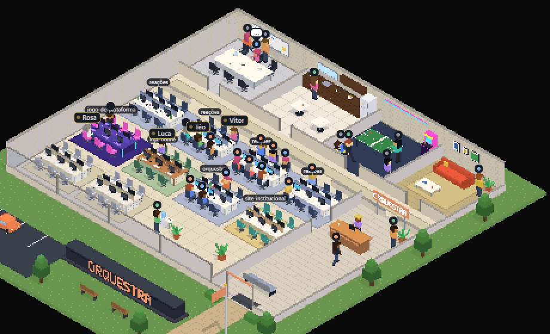
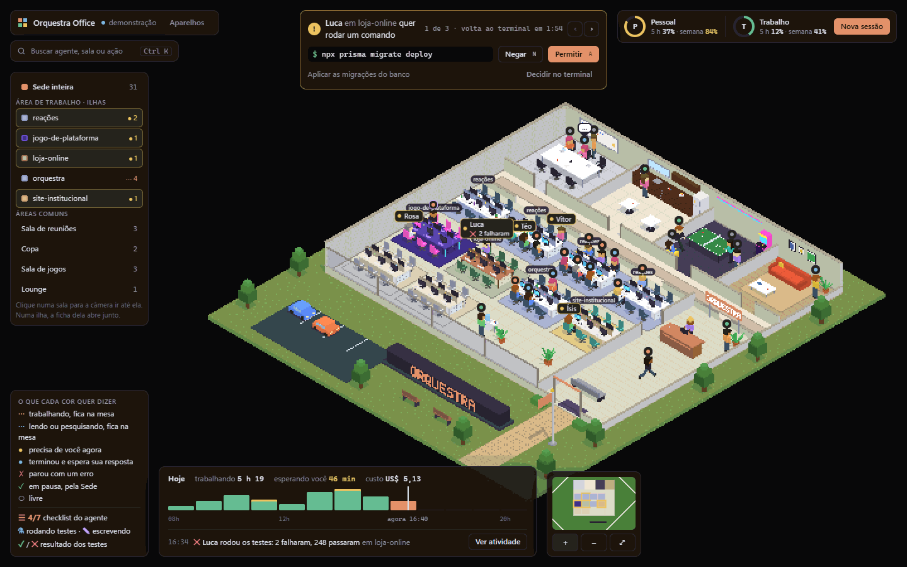
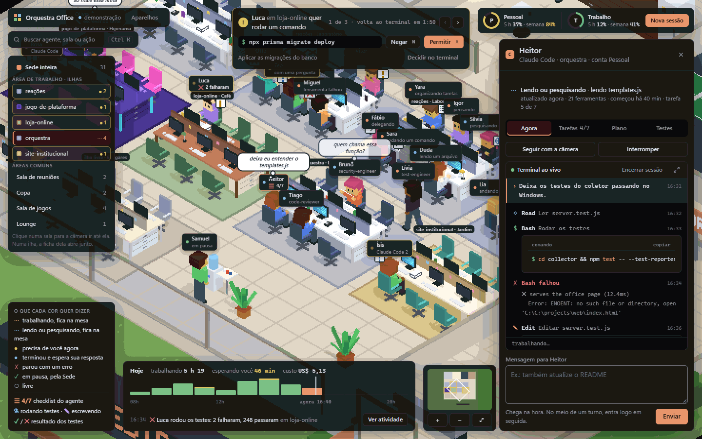
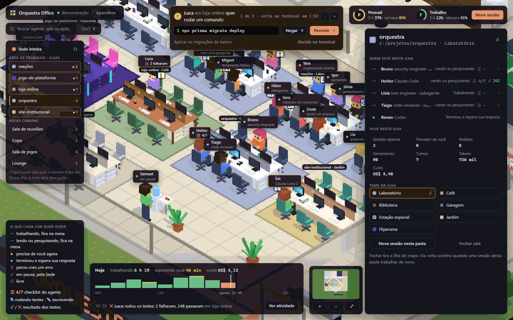
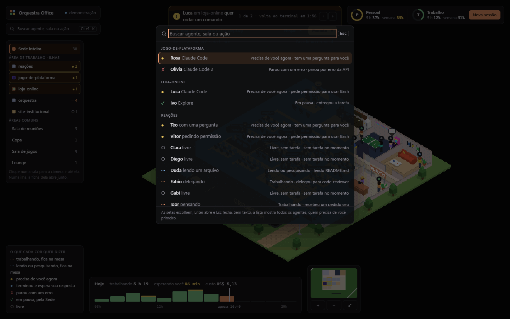
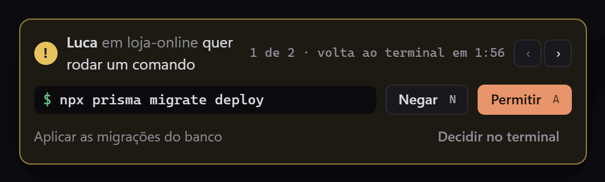
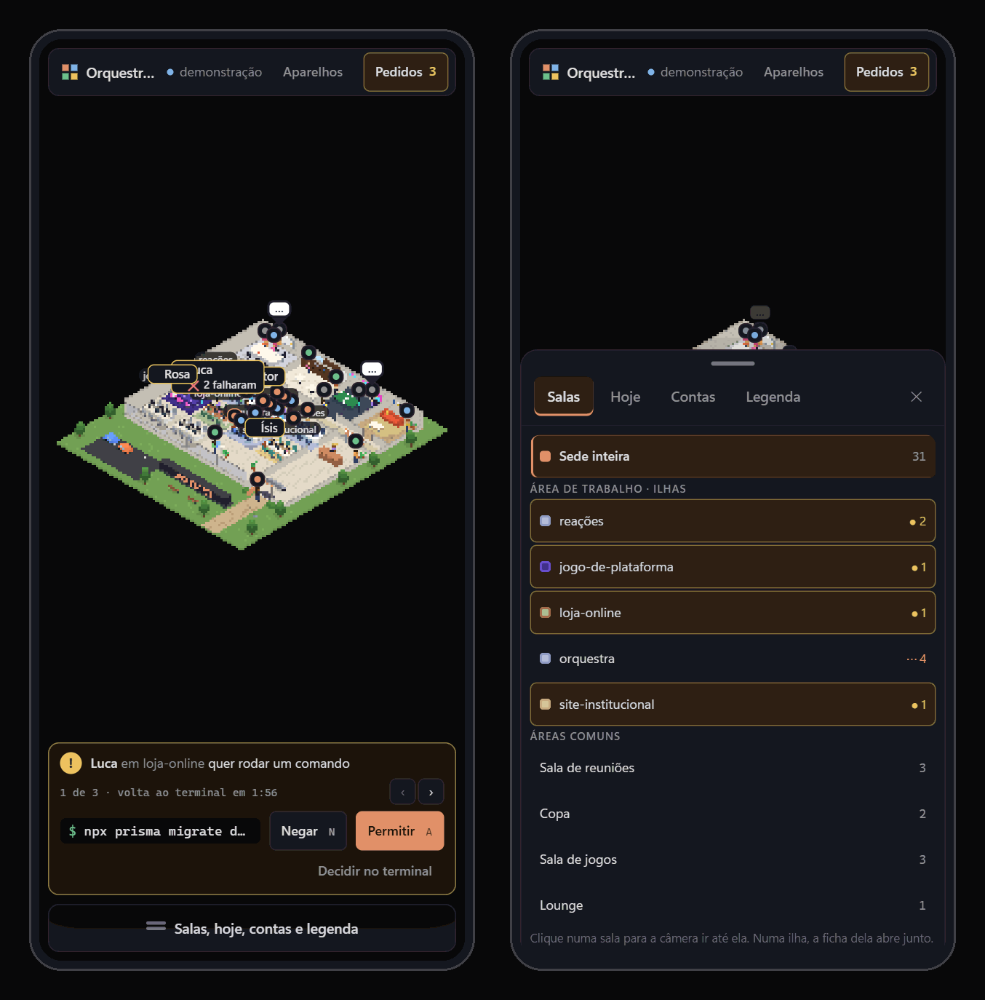
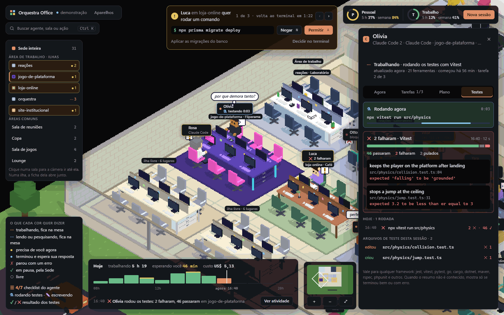
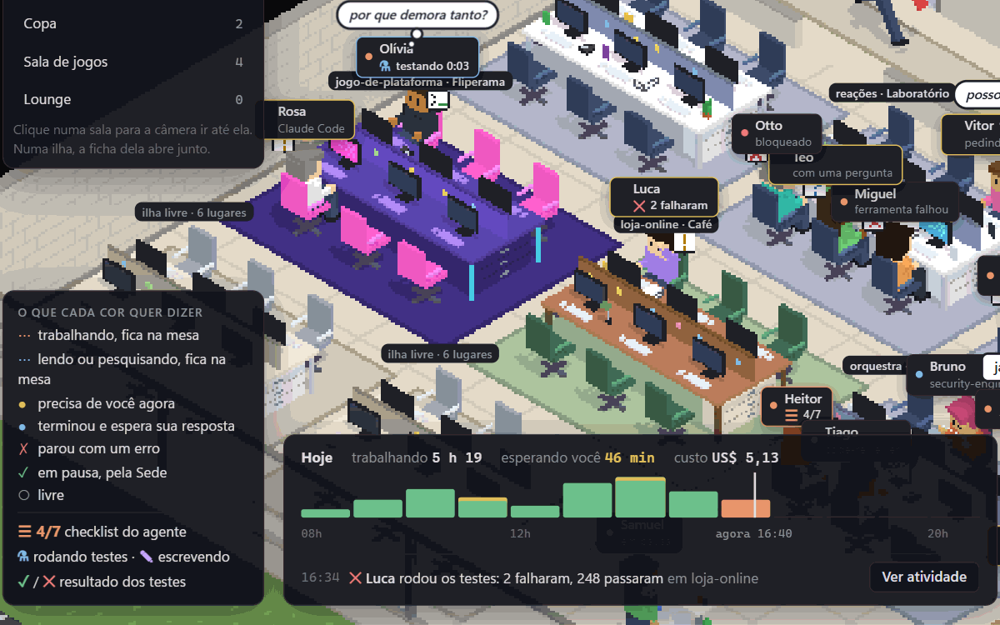
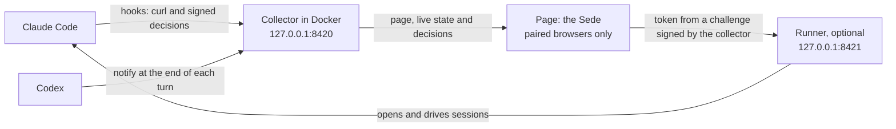

**English** | [Português (Brasil)](README.pt-BR.md)

# Orquestra Office

A pixel-art office for your coding agents: every Claude Code and Codex session gets a desk, shows what it is doing, and waits for your answer in the browser instead of the terminal.

[](https://github.com/lucascodev/orquestra-office/actions/workflows/ci.yml)
[](LICENSE)
[](https://nodejs.org/)
[](CONTRIBUTING.md#no-npm-dependencies)
[](https://lucascodev.github.io/orquestra-office/demo/?modo=demo)

<p align="center">
  <a href="https://lucascodev.github.io/orquestra-office/demo/?modo=demo">
    
  </a>
  <br>
  <sub><a href="https://lucascodev.github.io/orquestra-office/demo/?modo=demo">Open the live demo</a> (sample data, nothing to install) · <a href="https://lucascodev.github.io/orquestra-office/en/">Project page</a></sub>
</p>

> The office interface is in Portuguese only. This README names buttons in English with the on-screen label in parentheses, for example Allow (Permitir).

## What you can do

Each project folder gets an island of desks in the Sede (HQ), a single open-plan building seen from above. Each session sits at a desk, its subagents sit next to it, and the character shows what is going on: typing, reading, asking for your permission, waiting for you, on break or stuck on an error.

| In the office | Claude Code | Codex |
|---|---|---|
| Character and island per project | yes | yes |
| Live activity | yes | end of each turn only |
| Approve or deny a permission request | yes | no |
| Answer the agent's questions | yes | no |
| Send messages | yes: right away in sessions opened from the office, at the end of the turn in the others | no |
| Live terminal, interrupt and end the session | yes, in sessions opened from the office | no |
| Session history | yes, read-only | no |
| 5-hour and weekly plan usage | yes | no |
| Tokens and cost for the day | yes | no |
| Checklist, plan and tests in the agent sheet and on the map | yes | no |

Click a character, or its name in the island sheet or in search (`Ctrl K`, `Cmd K` on a Mac), to open its agent sheet in the drawer on the right. That is where the answer options, the message box and the history live. Permission requests also show up in the permission alert at the top of the screen, with Allow (Permitir) and Deny (Negar).

The agent sheet has four tabs: Now (Agora), with the status, the terminal and the message box; Tasks (Tarefas), with the agent's checklist; Plan (Plano), with the plan it proposed; and Tests (Testes), with every test run and its failures by name. The office recognizes test runs in any language, from jest and pytest to `go test`, `cargo test` and `dotnet test`, and shows a sign over the character: ⚗ while tests run, then ✓ or ✕ with the count. When the agent finishes a plan, the permission alert shows it, and only a click approves it.

<table>
  <tr>
    <td width="50%"><br><sub>The whole Sede: one island per project, with the common areas around them.</sub></td>
    <td width="50%"><br><sub>Agent sheet: status, live terminal and message box.</sub></td>
  </tr>
  <tr>
    <td><br><sub>Island sheet: who sits there, today's numbers and the island theme.</sub></td>
    <td><br><sub>Search finds agents, rooms and actions, with whoever needs you first.</sub></td>
  </tr>
  <tr>
    <td><br><sub>Permission alert: Allow (Permitir), Deny (Negar) or Decide in the terminal (Decidir no terminal).</sub></td>
    <td><br><sub>On a phone, the map fills the screen and the panels move to a bottom sheet.</sub></td>
  </tr>
  <tr>
    <td><br><sub>Tests (Testes) tab: the run in progress, the last run with each failure and the test files.</sub></td>
    <td><br><sub>Signs over the characters: ⚗ testing, ✓ passed, ✕ failed, ✎ writing a test and ☰ checklist.</sub></td>
  </tr>
</table>

The [guide](docs/guide.md) covers the rest: how characters behave, the agent sheet's terminal, approving and answering, checklist, plan and tests, messages, the runner, and usage and cost.

## How it works



- **Collector.** A small Node server with no dependencies, running in Docker on `http://127.0.0.1:8420`. It receives the events, keeps the state and serves the page.
- **Claude Code hooks.** The installer writes them to `~/.claude/settings.json`, so they apply to every project. Activity goes through the system `curl` in the background, without slowing tools down. Permission requests, questions and the end of a turn go through `hooks/office-decision.mjs`, which signs the request and only accepts a reply signed by the collector. The office status line (`hooks/office-statusline.mjs`) passes plan usage, tokens and cost on to the collector.
- **Codex notify hook.** Codex reports the end of each turn through `notify` in `~/.codex/config.toml`. That is all Codex reports, so it shows less detail than Claude Code.
- **Runner.** Optional. A small Node process that runs on your machine, outside Docker, and opens Claude Code sessions from the office. Only those sessions get the live terminal, instant messages, Interrupt (Interromper) and End session (Encerrar sessão). Start it with `node runner/src/main.js`.
- **Page.** The Sede, plain HTML, CSS and ES modules with no build step. Every browser that opens it must be [paired](#pair-your-browser).

Hooks, collector and runner trust each other through a secret that the installer creates in `~/.orquestra-office/secret`.

A project is the folder where the session started. A session opened in a git worktree joins the island of the main repository.

## Install

> An `npx orquestra-office` package is coming soon. For now, the office runs from a clone of this repository, with Docker.

You need:

- Node 22 or newer;
- Docker with Compose;
- the system `curl` (Windows 10 1803 or newer ships `C:\Windows\System32\curl.exe`; on macOS it is `/usr/bin/curl`);
- Claude Code, Codex or both.

The commands are the same in PowerShell and bash:

```bash
git clone https://github.com/lucascodev/orquestra-office.git
cd orquestra-office
node hooks/install-claude-hooks.mjs
node hooks/install-codex-notify.mjs
docker compose up -d --build
node hooks/open-office.mjs
```

- Skip the installer of the tool you do not use. Either one creates the secret.
- The installers come first because they create `~/.orquestra-office/secret`, which `compose.yaml` mounts into the container.
- The last command opens the office, already paired, in your default browser.
- Claude Code and Codex sessions opened **after** the install show up on their own.
- For the live terminal and instant messages, also start the runner: `node runner/src/main.js`.

After you pull a new version, run both installers again and `docker compose up -d --build`.

The installers only change what the office wrote and record it in `orquestra-office.json`, next to the configuration file. They can run again without duplicating anything. Before writing, they back up the file and keep the three latest backups. A backup is a full copy, so if the `env` block of your `settings.json` has tokens or passwords, the backup has them too. The [guide](docs/guide.md#how-the-installers-change-your-configuration) has the details: backups, atomic writes, the office address and the secret.

## Pair your browser

Every browser needs a pairing cookie to see or decide anything. The cookie lasts 90 days and is renewed every time the page loads. Without it, the page shows "This browser is not paired" (Este navegador não está pareado).

- **On this computer.** Run `node hooks/open-office.mjs` in the office folder. It asks the collector for a single-use challenge, valid for 30 seconds, then for a pairing code, with a request signed with the secret. Then it opens the paired office in your default browser at `http://127.0.0.1:8420`. For another browser, copy the address the command prints; it works once, for 2 minutes.
- **Use `127.0.0.1`, not `localhost`.** The cookie only applies to the address it was received on. On Windows, `localhost` resolves to `::1` first, where another process could be listening and would receive the pairing code and the cookie.
- **On another device.** In a paired browser, click Devices (Aparelhos), then Pair device (Parear aparelho). Scan the QR code with the other device or open the link on it. It also works once, for 2 minutes.
- **Revoke.** In Devices (Aparelhos), Revoke (Revogar) disconnects a device right away, and Sign out this one (Sair deste) disconnects the current browser.
- **Rotate the secret.** `node hooks/install-claude-hooks.mjs --rotate-secret` is the panic button: it invalidates every paired device, every runner token and every hook that still has the old secret. Then run `docker compose restart office`, because the mounted file does not change inside a running container.

## Uninstall

```bash
node hooks/install-claude-hooks.mjs --remove
node hooks/install-codex-notify.mjs --remove
docker compose down
```

`--remove` only takes out what the office wrote, and creates nothing if the configuration file does not exist. In `orquestra-office.json`, the Codex record is deleted and the Claude record is left empty, so a later install does not mistake a script or `curl` of yours for an old office hook. `docker compose down -v` also deletes the `office-data` volume.

The secret stays where it is. To delete it, remove the `~/.orquestra-office` folder:

```powershell
Remove-Item -Recurse "$HOME\.orquestra-office"
```

```bash
rm -r ~/.orquestra-office
```

If the container is stopped, activity is lost silently, decisions go back to the terminal and Claude Code carries on as usual.

## Updating from the `http` hooks

Earlier versions used hooks of type `http`. They no longer work: the new collector answers them without effect, and the page shows "There are hooks from an old version on this computer" (Há hooks de uma versão antiga neste computador). The warning goes away 10 minutes after the last request from an old hook. To migrate:

1. Run `node hooks/install-claude-hooks.mjs` once for each Claude Code configuration folder you use (with `CLAUDE_CONFIG_DIR` pointing to it), and `node hooks/install-codex-notify.mjs`. The installer replaces the `http` entries with the new ones, creates the secret and says it migrated. If a `~/.orquestra-office/secret` already exists and you did not create it with the installer, or you are not sure where it came from, run the first installer with `--rotate-secret`: it replaces the key before the collector starts using it.
2. Rebuild the collector with `docker compose up -d --build`. It reads the secret from `~/.orquestra-office/secret`; if the file does not exist, run the installer first.
3. Run `node hooks/open-office.mjs` to pair your browser. Pair your phone with the QR code in Devices (Aparelhos).
4. Restart the runner, if you use it: `node runner/src/main.js`.

Sessions that are already open keep the old hooks until they are closed.

## What is stored

**On disk** (the `office-data` volume), only what is needed to draw the office: project folder, session id, subagent name, tool name, file name (without the path), the first word of a command (for example `cargo`, never the arguments) and the token and cost totals. For tests, it also keeps the counts of each run (passed, failed and skipped), the framework and the test files' paths relative to the project, never the test command. For the plan, only its version, state and times.

**Paired devices** (`devices.json`, in the same volume): the browser name, the address it was opened from, the dates and the SHA-256 hash of the cookie, never the cookie itself. A device unused for 30 days drops off the list.

**Only in the collector's memory**, for the history and so you can decide with context: the text of your prompts, full commands, the agent's last reply in each turn, pending permission requests, queued messages, unused pairing codes, the agent's checklist, the text of its plan and up to 10 failures of the last test run. None of this goes to disk, and all of it is lost when the container restarts. The history keeps at most 200 entries per session.

**Test output is never stored whole.** The collector reads the counts and up to 10 failures (name, place and message, each cut to 300 characters) and drops the rest. Before it keeps the test command (in memory only), the failures, the plan or the checklist, it masks tokens, keys, JWTs, credentials in URLs and `password=` or `token=` values.

**In your home folder** (`~/.orquestra-office`, created by the installer and readable only by your user): `secret`, the key shared by hooks, collector and runner, and `activity.header`, the header with the activity token that `curl` reads. The token lives in a file, not on the command line, because on macOS and Linux any user can see the command line of running processes.

By default the collector only accepts connections from your machine (`127.0.0.1`). Every `/api/*` route requires a paired browser, and control actions refuse requests that come from another site open in the browser or that lack the page's own origin.

## Open on your local network

To use the office on your phone, also publish the port on the machine's local network IP. Create a `.env` file in the office folder with that IP:

```dotenv
OFFICE_LAN_IP=192.168.0.10
```

Then start the collector with `compose.lan.yaml`, which adds the port and allows that address in the collector:

```bash
docker compose -f compose.yaml -f compose.lan.yaml up -d --build
```

Pair the phone with the QR code (Devices (Aparelhos), then Pair device (Parear aparelho), in a paired browser). The QR link already points to `http://<OFFICE_LAN_IP>:8420`. To go back to local only, run `docker compose up -d` without the second file.

- A device on the network that was not paired sees nothing: every `/api/*` route answers `401`, also for requests that send `Host: localhost`. Hook routes require the token or the signature.
- A paired device has full control: it sees the sessions, approves permissions and sends messages. Revoke a lost device in Devices (Aparelhos).
- LAN mode is plain HTTP: anyone who can sniff the network can copy the cookie of a paired device. Only turn it on in a network you trust.
- Only paired pages count as viewers; a random page opened on the network does not hold permission requests away from the terminal.
- If the machine's IP changes, update `OFFICE_LAN_IP` in `.env` and start the collector again.
- The runner stays on `127.0.0.1` only. New session (Nova sessão), the live terminal, interrupt and end do not work from the phone.

## Development

The project has no npm dependencies and the page has no build step. There are five test suites, and CI runs all of them on Node 22 for every pull request and every push to `main`:

```bash
node --test site/test/*.test.mjs
node --test web/test/*.test.js
cd collector
npm test
cd ../runner
npm test
cd ..
node --test hooks/test/*.test.mjs
```

[CONTRIBUTING.md](CONTRIBUTING.md) explains how to run the office locally with sample data, the layered architecture, the code rules and the commit format.

Browser libraries are copied into `web/vendor`, each with its license next to it:

| Library | Version | What for |
|---|---|---|
| three.js | r187 | the Sede in 3D |
| marked | 18.1.3 | markdown in the agent's replies in the terminal |
| DOMPurify | 3.4.17 | cleaning the HTML generated from markdown before showing it |
| highlight.js | 11.12.0 (ES build from `@highlightjs/cdn-assets`) | syntax colors |
| uqr | 0.1.3 (`dist/index.mjs`) | the QR code to pair another device; the page draws the SVG from the matrix |

To update one, download the package from npm, check the registry `integrity` hash and replace the file in `web/vendor`. DOMPurify and uqr keep the `.js` extension, because the collector's server does not serve `.mjs`.

The signed protocol has two copies, `collector/src/shared/auth/signed-message.js` and `hooks/lib/signed-message.mjs`, because the `hooks/` folder must stay copyable on its own. Both test suites use the same fixed vectors, so a change to only one of them breaks a test.

### Landing page

The landing page lives in `site/`: Portuguese in `site/index.html`, English in `site/en/index.html`. `node site/assemble.mjs _site` builds the published site, with the landing page at the root and the office in demo mode under `demo/`. The `Pages` workflow runs the tests, builds the site and publishes it on every push to `main`.

In a fork, replace the repository and the `https://lucascodev.github.io/orquestra-office/` address in both pages. If an `OWNER` placeholder is left in a page, the build fails and nothing is deployed.

## Security

The office writes to your Claude Code and Codex configuration and decides permission requests on your behalf. Read [SECURITY.md](SECURITY.md) for the threat model and for how to report a vulnerability privately. Do not open a public issue for one.

## License

[MIT](LICENSE).
