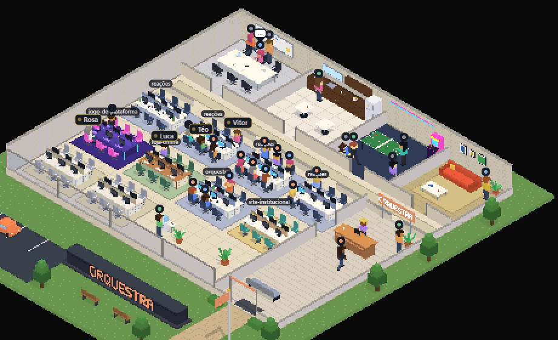
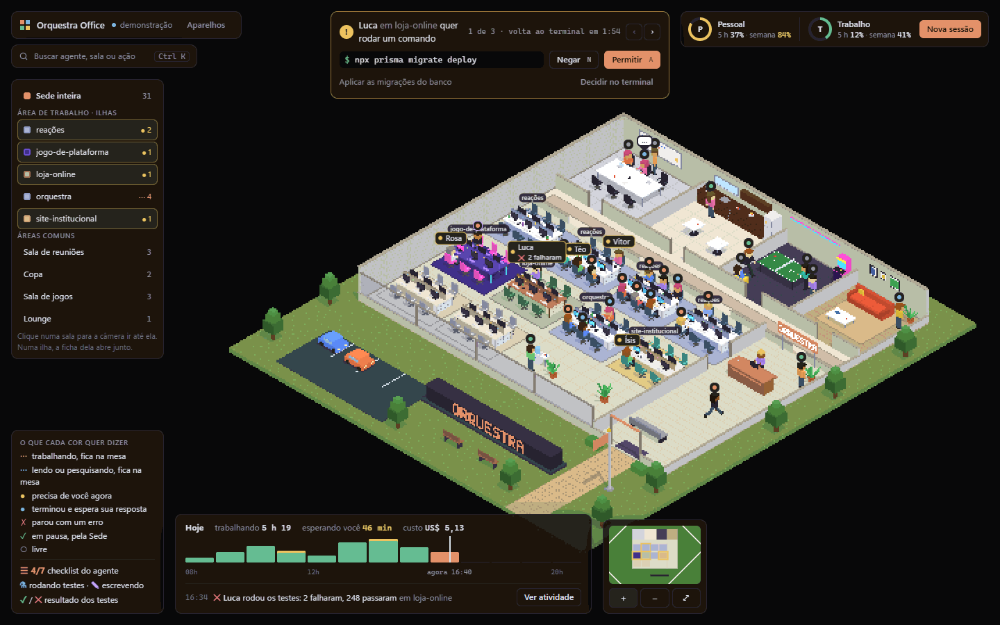
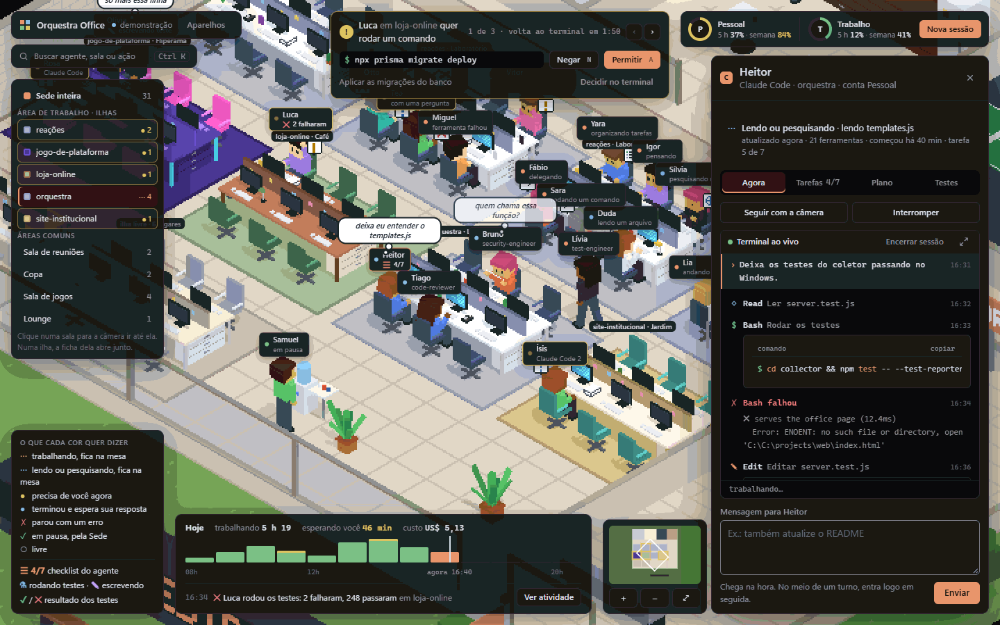
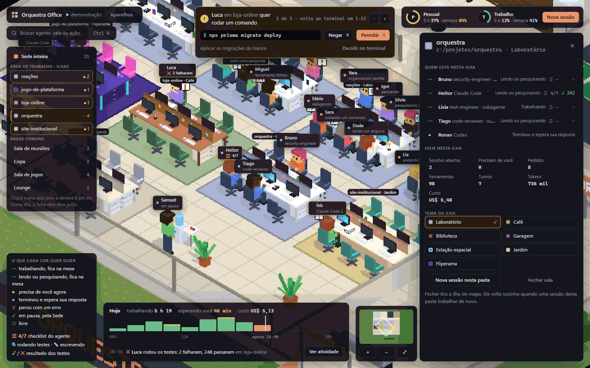
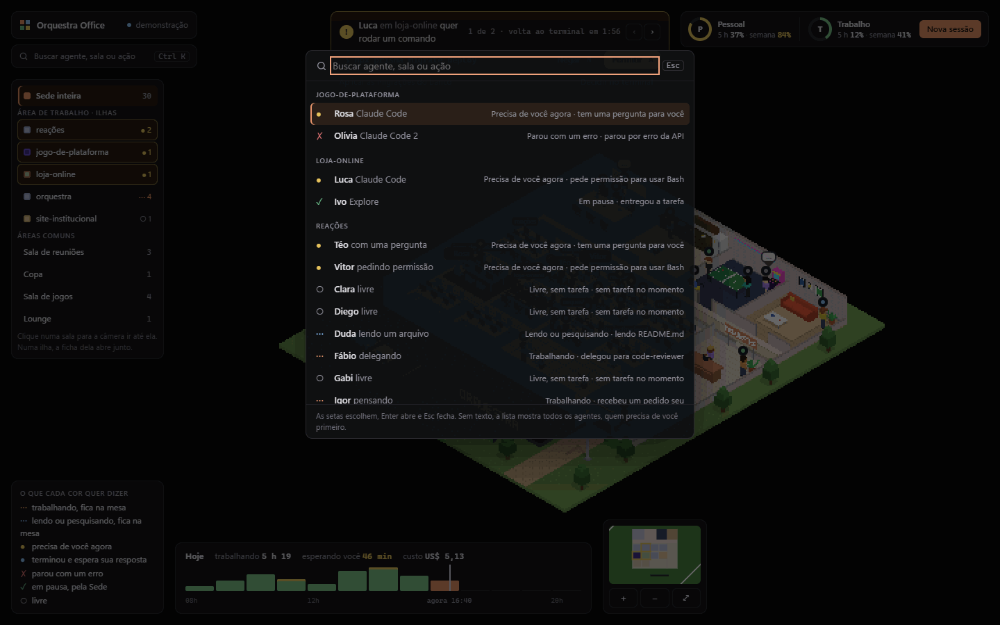
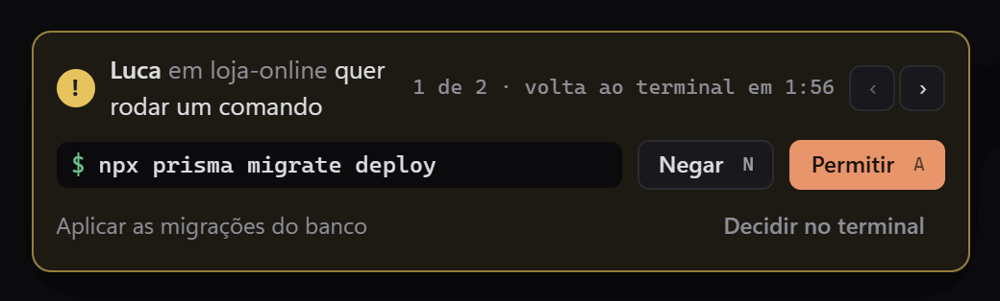
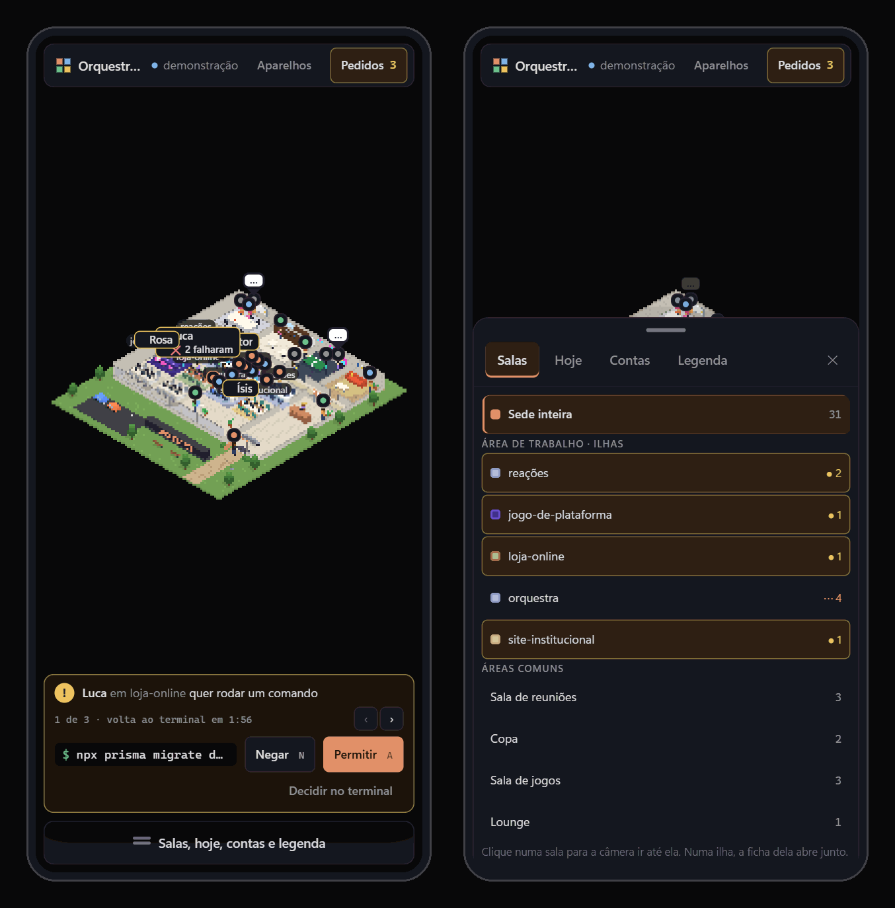
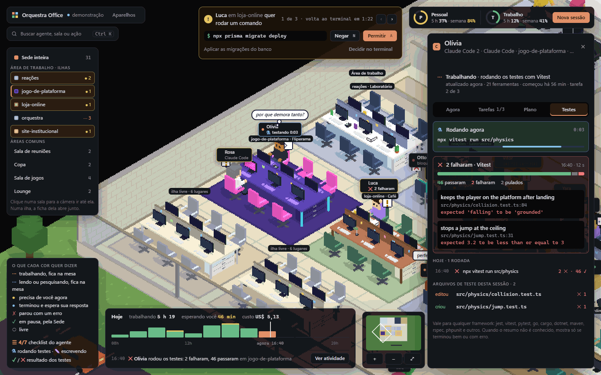
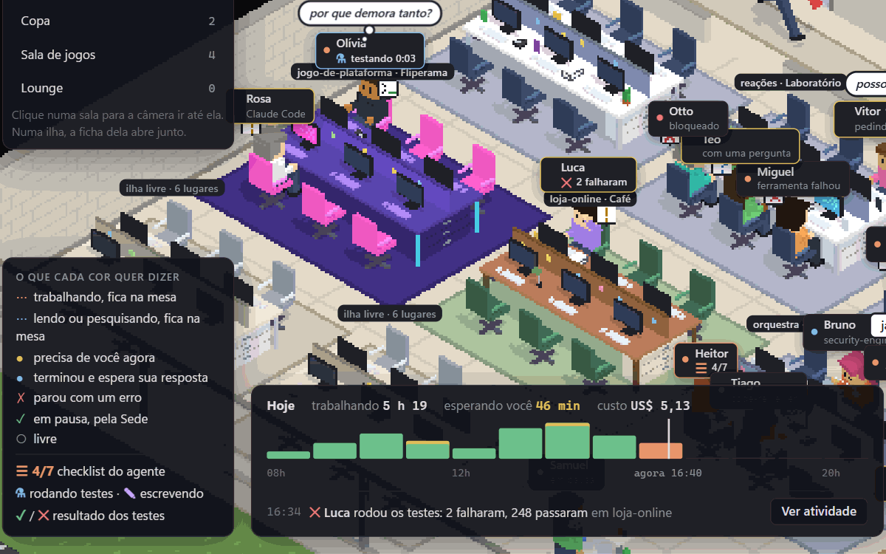
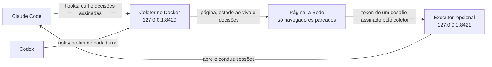

[English](README.md) | **Português (Brasil)**

# Orquestra Office

Um escritório em pixel art para os seus agentes de código: cada sessão do Claude Code e do Codex ganha uma mesa, mostra o que está fazendo e espera a sua resposta no navegador, em vez do terminal.

[](https://github.com/lucascodev/orquestra-office/actions/workflows/ci.yml)
[](LICENSE)
[](https://nodejs.org/)
[](CONTRIBUTING.pt-BR.md#sem-dependências-npm)
[](https://lucascodev.github.io/orquestra-office/demo/?modo=demo)

<p align="center">
  <a href="https://lucascodev.github.io/orquestra-office/demo/?modo=demo">
    
  </a>
  <br>
  <sub><a href="https://lucascodev.github.io/orquestra-office/demo/?modo=demo">Abrir a demo ao vivo</a> (dados de exemplo, nada a instalar) · <a href="https://lucascodev.github.io/orquestra-office/">Página do projeto</a></sub>
</p>

> A interface do escritório é só em português. Os nomes dos botões neste README são os mesmos da tela, por exemplo **Permitir**.

## O que dá para fazer

Cada pasta de projeto ganha uma ilha de mesas na Sede, um prédio térreo aberto visto de cima. Cada sessão senta numa mesa, os subagentes sentam ao lado dela, e o boneco mostra o que está acontecendo: digitando, lendo, pedindo sua permissão, esperando você, em pausa ou parado com um erro.

| No escritório | Claude Code | Codex |
|---|---|---|
| Boneco e ilha por projeto | sim | sim |
| Atividade ao vivo | sim | só o fim de cada turno |
| Aprovar ou recusar um pedido de permissão | sim | não |
| Responder perguntas do agente | sim | não |
| Mandar mensagens | sim: na hora nas sessões abertas pelo escritório, no fim do turno nas demais | não |
| Terminal ao vivo, interromper e encerrar a sessão | sim, nas sessões abertas pelo escritório | não |
| Histórico da sessão | sim, somente leitura | não |
| Uso do plano de 5 h e semanal | sim | não |
| Tokens e custo do dia | sim | não |
| Checklist, plano e testes na ficha e no mapa | sim | não |

Clique num boneco, ou no nome dele na ficha da ilha ou na busca (`Ctrl K`, `Cmd K` no Mac), para abrir a ficha do agente, na gaveta à direita do mapa. É nela que ficam as opções de resposta, a caixa de mensagem e o histórico. Os pedidos de permissão aparecem também no alerta de permissão no alto da tela, com **Permitir** e **Negar**.

A ficha do agente tem quatro abas: **Agora**, com o status, o terminal e a caixa de mensagem; **Tarefas**, com a checklist do agente; **Plano**, com o plano que ele propôs; e **Testes**, com cada rodada de testes e as falhas pelo nome. O escritório reconhece testes em qualquer linguagem, do jest e do pytest ao `go test`, `cargo test` e `dotnet test`, e mostra um sinal em cima do boneco: ⚗ enquanto os testes rodam, depois ✓ ou ✕ com a contagem. Quando o agente termina um plano, o alerta de permissão mostra o plano, e só um clique aprova.

<table>
  <tr>
    <td width="50%"><br><sub>A Sede inteira: uma ilha por projeto, com as áreas comuns em volta.</sub></td>
    <td width="50%"><br><sub>Ficha do agente: status, terminal ao vivo e caixa de mensagem.</sub></td>
  </tr>
  <tr>
    <td><br><sub>Ficha da ilha: quem senta nela, os números do dia e o tema da ilha.</sub></td>
    <td><br><sub>A busca encontra agentes, salas e ações, com quem precisa de você primeiro.</sub></td>
  </tr>
  <tr>
    <td><br><sub>Alerta de permissão: <b>Permitir</b>, <b>Negar</b> ou <b>Decidir no terminal</b>.</sub></td>
    <td><br><sub>No celular, o mapa ocupa a tela e os painéis vão para uma folha de baixo.</sub></td>
  </tr>
  <tr>
    <td><br><sub>Aba <b>Testes</b>: a rodada em andamento, a última rodada com cada falha e os arquivos de teste.</sub></td>
    <td><br><sub>Sinais em cima dos bonecos: ⚗ testando, ✓ passaram, ✕ falharam, ✎ escrevendo teste e ☰ checklist.</sub></td>
  </tr>
</table>

O [guia de uso](docs/guia.md) cobre o resto: como os bonecos se comportam, o terminal da ficha, aprovar e responder, checklist, plano e testes, mensagens, o executor, e uso e custo.

## Como funciona



- **Coletor.** Um servidor Node pequeno, sem dependências, que roda no Docker em `http://127.0.0.1:8420`. Ele recebe os eventos, guarda o estado e serve a página.
- **Hooks do Claude Code.** O instalador grava os hooks no `~/.claude/settings.json`, então eles valem para todos os projetos. A atividade vai pelo `curl` do sistema, em segundo plano, sem atrasar as ferramentas. Pedidos de permissão, perguntas e o fim do turno passam por `hooks/office-decision.mjs`, que assina o pedido e só aceita uma resposta assinada pelo coletor. A linha de status do escritório (`hooks/office-statusline.mjs`) repassa ao coletor o uso do plano, os tokens e o custo.
- **Notify do Codex.** O Codex avisa o fim de cada turno pelo `notify` do `~/.codex/config.toml`. É só isso que o Codex avisa, então ele aparece com menos detalhe que o Claude Code.
- **Executor.** Opcional. Um processo Node pequeno que roda na sua máquina, fora do Docker, e abre sessões do Claude Code pelo escritório. Só essas sessões têm terminal ao vivo, mensagem na hora, **Interromper** e **Encerrar sessão**. Ligue com `node runner/src/main.js`.
- **Página.** A Sede, em HTML, CSS e módulos ES, sem etapa de build. Cada navegador que abre a página precisa estar [pareado](#parear-o-navegador).

Hooks, coletor e executor se reconhecem por um segredo que o instalador cria em `~/.orquestra-office/secret`.

O projeto é a pasta onde a sessão começou. Uma sessão aberta num worktree do git entra na ilha do repositório principal.

## Instalar

> Um pacote `npx orquestra-office` vem em breve. Por enquanto, o escritório roda a partir de um clone deste repositório, com Docker.

Você precisa de:

- Node 22 ou mais novo;
- Docker com Compose;
- o `curl` do sistema (o Windows 10 1803 ou mais novo já traz `C:\Windows\System32\curl.exe`; no macOS, é o `/usr/bin/curl`);
- Claude Code, Codex ou os dois.

Os comandos são os mesmos no PowerShell e no bash:

```bash
git clone https://github.com/lucascodev/orquestra-office.git
cd orquestra-office
node hooks/install-claude-hooks.mjs
node hooks/install-codex-notify.mjs
docker compose up -d --build
node hooks/open-office.mjs
```

- Pule o instalador da ferramenta que você não usa. Qualquer um dos dois cria o segredo.
- Os instaladores vêm primeiro porque criam o `~/.orquestra-office/secret`, que o `compose.yaml` monta no container.
- O último comando abre o escritório, já pareado, no navegador padrão.
- As sessões do Claude Code e do Codex abertas **depois** da instalação aparecem sozinhas.
- Para ter terminal ao vivo e mensagem na hora, ligue também o executor: `node runner/src/main.js`.

Depois de atualizar esta pasta, rode de novo os dois instaladores e `docker compose up -d --build`.

Os instaladores só mexem no que o escritório gravou e anotam isso em `orquestra-office.json`, na mesma pasta do arquivo de configuração. Eles podem rodar de novo sem duplicar nada. Antes de gravar, fazem backup do arquivo e guardam os três backups mais recentes. O backup é uma cópia inteira: se o `env` do seu `settings.json` tiver tokens ou senhas, o backup também terá. O [guia de uso](docs/guia.md#como-os-instaladores-mexem-na-sua-configuração) traz os detalhes: backup, gravação atômica, endereço do escritório e segredo.

## Parear o navegador

Cada navegador precisa de um cookie de pareamento para ver ou decidir qualquer coisa. O cookie vale 90 dias e é renovado sempre que a página carrega. Sem ele, a página mostra "Este navegador não está pareado".

- **Neste computador.** Rode `node hooks/open-office.mjs` na pasta do escritório. Ele pede ao coletor um desafio de uso único, que vale 30 segundos, e depois um código de pareamento, com um pedido assinado pelo segredo. Em seguida, abre o escritório já pareado no navegador padrão, em `http://127.0.0.1:8420`. Para outro navegador, copie o endereço que o comando mostra; ele vale uma vez, por 2 minutos.
- **Use `127.0.0.1`, não `localhost`.** O cookie vale só para o endereço em que foi recebido. No Windows, `localhost` resolve primeiro para `::1`, onde outro processo pode estar escutando e receberia o código de pareamento e o cookie.
- **Em outro aparelho.** Num navegador já pareado, clique em **Aparelhos** e depois em **Parear aparelho**. Leia o QR com o outro aparelho ou abra o link nele. Também vale uma vez, por 2 minutos.
- **Revogar.** Em **Aparelhos**, **Revogar** desconecta o aparelho na hora, e **Sair deste** desconecta o navegador atual.
- **Girar o segredo.** `node hooks/install-claude-hooks.mjs --rotate-secret` é o botão de pânico: invalida todos os aparelhos pareados, os tokens do executor e qualquer hook com o segredo antigo. Depois, rode `docker compose restart office`, porque o arquivo montado não muda dentro de um container que já está rodando.

## Desinstalar

```bash
node hooks/install-claude-hooks.mjs --remove
node hooks/install-codex-notify.mjs --remove
docker compose down
```

O `--remove` tira só o que o escritório gravou e não cria nada se o arquivo de configuração não existir. Em `orquestra-office.json`, a anotação do Codex é apagada e a do Claude fica vazia, para que uma instalação seguinte não confunda um script ou um `curl` seu com um hook antigo do escritório. O `docker compose down -v` apaga também o volume `office-data`.

O segredo fica onde está. Para apagá-lo, remova a pasta `~/.orquestra-office`:

```powershell
Remove-Item -Recurse "$HOME\.orquestra-office"
```

```bash
rm -r ~/.orquestra-office
```

Se o container estiver parado, a atividade se perde sem aviso, as decisões voltam para o terminal e o Claude Code continua normalmente.

## Atualizar de uma versão com hooks `http`

As versões anteriores usavam hooks do tipo `http`. Eles deixam de valer: o coletor novo responde a eles sem efeito, e a página avisa "Há hooks de uma versão antiga neste computador". O aviso some 10 minutos depois do último pedido de um hook antigo. Para migrar:

1. Rode `node hooks/install-claude-hooks.mjs` uma vez para cada pasta de configuração do Claude Code que você usa (com `CLAUDE_CONFIG_DIR` apontando para ela) e `node hooks/install-codex-notify.mjs`. O instalador troca as entradas `http` pelas novas, cria o segredo e avisa que migrou. Se já existe um `~/.orquestra-office/secret` que você não criou com o instalador, ou de que não tem certeza de onde veio, rode o primeiro instalador com `--rotate-secret`: ele troca a chave por uma nova antes de o coletor passar a usá-la.
2. Reconstrua o coletor com `docker compose up -d --build`. Ele lê o segredo de `~/.orquestra-office/secret`; se o arquivo não existir, rode o instalador antes.
3. Rode `node hooks/open-office.mjs` para parear o navegador. Pareie o celular pelo QR em **Aparelhos**.
4. Reinicie o executor, se você usa: `node runner/src/main.js`.

As sessões já abertas continuam com os hooks antigos até serem fechadas.

## O que fica guardado

**No disco** (volume `office-data`), só o necessário para desenhar o escritório: pasta do projeto, id da sessão, nome do subagente, nome da ferramenta, nome do arquivo (sem o caminho), o primeiro termo do comando (por exemplo `cargo`, nunca os argumentos) e os totais de tokens e custo. Dos testes, ficam também os números de cada rodada (passaram, falharam e pulados), o framework e o caminho dos arquivos de teste a partir da pasta do projeto, nunca o comando de teste. Do plano, só a versão, o estado e os horários.

**Aparelhos pareados** (`devices.json`, no mesmo volume): o nome do navegador, o endereço por onde foi aberto, as datas e o hash SHA-256 do cookie, nunca o cookie. Um aparelho sem uso por 30 dias sai da lista.

**Só na memória do coletor**, para o histórico e para você decidir com contexto: o texto dos seus pedidos, os comandos completos, a última resposta do agente em cada turno, os pedidos de permissão pendentes, as mensagens na fila, os códigos de pareamento ainda não usados, a checklist do agente, o texto do plano e até 10 falhas da última rodada de testes. Nada disso vai para o disco, e tudo se perde quando o container reinicia. O histórico guarda no máximo 200 registros por sessão.

**A saída dos testes nunca é guardada inteira.** O coletor lê os números e até 10 falhas (nome, local e mensagem, cada um cortado em 300 caracteres) e descarta o resto. Antes de guardar o comando de teste (só em memória), as falhas, o plano ou a checklist, ele mascara tokens, chaves, JWT, credenciais em URL e valores de `password=` ou `token=`.

**Na sua pasta pessoal** (`~/.orquestra-office`, criada pelo instalador e legível só pelo seu usuário): `secret`, a chave que hooks, coletor e executor compartilham, e `activity.header`, o cabeçalho com o token de atividade que o `curl` lê. O token fica num arquivo, e não na linha de comando, porque no macOS e no Linux qualquer usuário vê a linha de comando dos processos.

Por padrão, o coletor só aceita conexões da sua máquina (`127.0.0.1`). Todo `/api/*` exige um navegador pareado, e as ações de controle recusam pedidos vindos de outro site aberto no navegador ou sem a origem da própria página.

## Abrir na rede local

Para usar o escritório no celular, publique a porta também no IP da máquina na rede local. Crie um arquivo `.env` na pasta do escritório com esse IP:

```dotenv
OFFICE_LAN_IP=192.168.0.10
```

Depois, suba o coletor com o `compose.lan.yaml`, que acrescenta a porta e libera esse endereço no coletor:

```bash
docker compose -f compose.yaml -f compose.lan.yaml up -d --build
```

Pareie o celular pelo QR (**Aparelhos**, **Parear aparelho**, num navegador já pareado). O link do QR já aponta para `http://<OFFICE_LAN_IP>:8420`. Para voltar ao modo só local, rode `docker compose up -d` sem o segundo arquivo.

- Um aparelho da rede que não foi pareado não vê nada: todo `/api/*` responde `401`, também para quem manda `Host: localhost`. As rotas dos hooks exigem o token ou a assinatura.
- Pareado, o aparelho tem controle total: vê as sessões, aprova permissões e manda mensagens. Revogue em **Aparelhos** um aparelho perdido.
- O modo rede é HTTP: quem escuta o tráfego da rede consegue copiar o cookie de um aparelho pareado. Só ligue em rede em que você confia.
- Só páginas pareadas contam como espectador; uma página qualquer aberta na rede não segura pedidos de permissão longe do terminal.
- Se o IP da máquina mudar, atualize `OFFICE_LAN_IP` no `.env` e suba o coletor de novo.
- O executor continua só em `127.0.0.1`. **Nova sessão**, terminal ao vivo, interromper e encerrar não funcionam pelo celular.

## Desenvolvimento

O projeto não tem dependências npm e a página não tem etapa de build. São cinco suítes de teste, e o CI roda todas com Node 22 em todo pull request e em todo push na `main`:

```bash
node --test site/test/*.test.mjs
node --test web/test/*.test.js
cd collector
npm test
cd ../runner
npm test
cd ..
node --test hooks/test/*.test.mjs
```

O [CONTRIBUTING.pt-BR.md](CONTRIBUTING.pt-BR.md) explica como rodar o escritório localmente com dados de exemplo, a arquitetura em camadas, as regras do código e o formato dos commits.

As bibliotecas do navegador ficam copiadas em `web/vendor`, cada uma com a licença ao lado:

| Biblioteca | Versão | Para quê |
|---|---|---|
| three.js | r187 | a Sede em 3D |
| marked | 18.1.3 | markdown das respostas do agente no terminal |
| DOMPurify | 3.4.17 | limpar o HTML gerado do markdown antes de mostrar |
| highlight.js | 11.12.0 (build ES do `@highlightjs/cdn-assets`) | cores de sintaxe |
| uqr | 0.1.3 (`dist/index.mjs`) | QR para parear outro aparelho; a página desenha o SVG a partir da matriz |

Para atualizar uma delas, baixe o pacote do npm, confira o hash `integrity` do registro e substitua o arquivo em `web/vendor`. O DOMPurify e o uqr vão com a extensão `.js`, porque o servidor do coletor não serve `.mjs`.

O protocolo assinado tem duas cópias, `collector/src/shared/auth/signed-message.js` e `hooks/lib/signed-message.mjs`, porque a pasta `hooks/` precisa continuar copiável sozinha. Os testes das duas usam os mesmos vetores fixos, e uma mudança em só uma delas quebra o teste.

### Landing

A landing fica em `site/`: português em `site/index.html`, inglês em `site/en/index.html`. O `node site/assemble.mjs _site` monta o site publicado, com a landing na raiz e o escritório em modo demo em `demo/`. O workflow `Pages` roda os testes, monta o site e publica a cada push na `main`.

Num fork, troque o repositório e o endereço `https://lucascodev.github.io/orquestra-office/` nas duas páginas. Se sobrar o marcador `OWNER` numa página, a montagem para com erro e o deploy não acontece.

## Segurança

O escritório grava na configuração do Claude Code e do Codex e decide pedidos de permissão em seu nome. Leia a [política de segurança](SECURITY.pt-BR.md) para ver o modelo de ameaça e como relatar uma falha em particular. Não abra issue pública para isso.

## Licença

[MIT](LICENSE).
