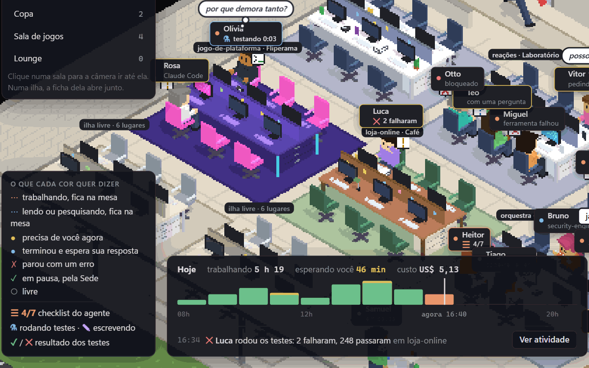
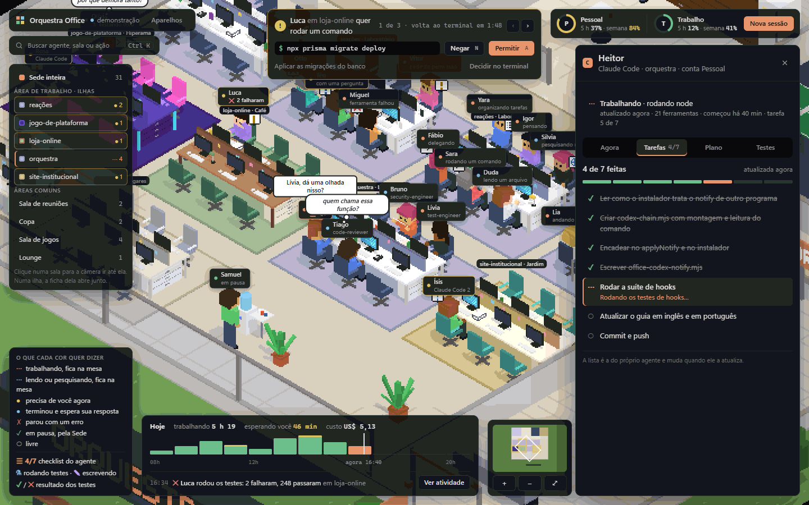
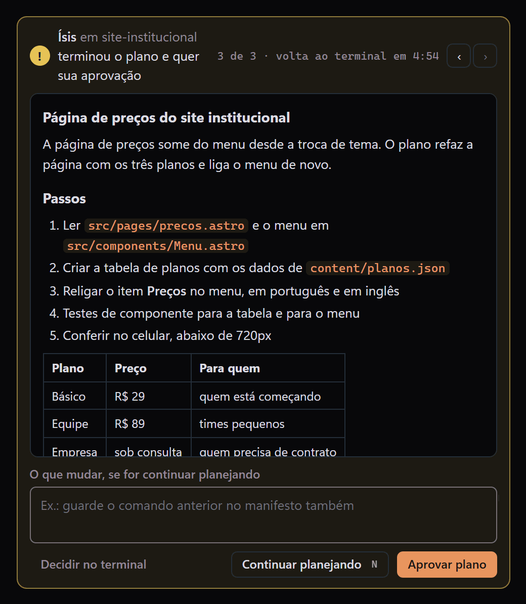
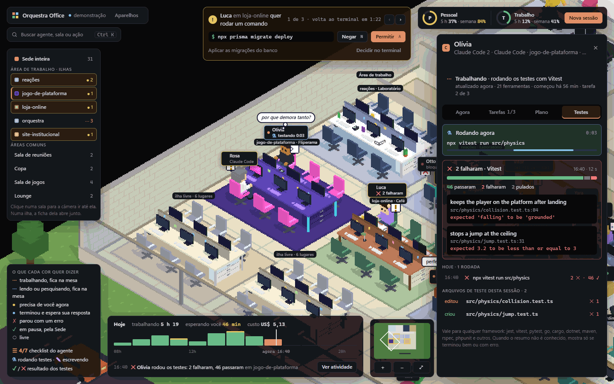

[English](guide.md) | **Português (Brasil)**

# Guia de uso

Como o escritório se comporta depois de instalado. Instalar, parear e desinstalar estão no [README](../README.pt-BR.md).

## A Sede

- Todos os projetos dividem a mesma Sede, um escritório térreo aberto visto de cima. Cada projeto ganha uma ilha de 6 lugares na área de trabalho; um projeto com mais gente ganha mais de uma ilha. As sessões e seus subagentes sentam juntos, e os lugares livres ficam à vista.
- Cada ilha tem um dos 7 temas, que pinta o tapete, as mesas e as cadeiras dela: Laboratório, Café, Biblioteca, Garagem, Estação espacial, Jardim e Fliperama. O tema se escolhe na ficha da ilha, aberta pelo nome do projeto na lista de salas ou com um clique na ilha.
- Em volta das ilhas ficam as áreas comuns, de todos os projetos: sala de reuniões, copa, sala de jogos, lounge e recepção, e o quintal na frente do prédio.
- Cada boneco leva uma etiqueta com o nome, o título e a cor do status. Quem tem mensagens na fila mostra quantas na etiqueta e na ficha da ilha. Enquanto o agente testa ou avança na checklist, a etiqueta mostra também um sinal (veja [Sinais em cima do boneco](#sinais-em-cima-do-boneco)).
- Uma sessão aberta num worktree do git entra na ilha do repositório principal.
- Os papéis definidos em `.claude/agents` do projeto ganham mesa com o nome mesmo quando ninguém está no papel. Só os nomes dos arquivos são lidos.
- A interface segue o Orquestra Design System: os mesmos tokens de cor, tipografia, espaço e raio (`web/styles/tokens.css`), status sempre com glifo e texto, e o painel de terminal do app.

## A ficha do agente

Clique num boneco, ou no nome dele na ficha da ilha ou na busca (`Ctrl K`, `Cmd K` no Mac), para abrir a ficha do agente, na gaveta à direita do mapa. É nela que ficam as opções de resposta, a caixa de mensagem e o histórico.

Para alargar a gaveta, passe o mouse na borda esquerda dela e arraste. A largura fica guardada no navegador; duplo clique na borda volta ao padrão, e com o foco na borda as setas também mudam a largura.

A ficha tem quatro abas: **Agora**, **Tarefas**, **Plano** e **Testes**. A aba Agora tem o status, o terminal e a caixa de mensagem, descritos a seguir. As outras três estão em [Checklist, plano e testes](#checklist-plano-e-testes).

O terminal da ficha:

- Cada linha leva o horário e um ícone colorido pelo tipo de ferramenta: leitura, edição, comando, web, delegação, lista de tarefas.
- As respostas do agente aparecem formatadas como markdown, com listas, negrito, links e blocos de código com cores de sintaxe.
- Uma edição aparece como diff, com as linhas removidas em vermelho e as adicionadas em verde. Um arquivo escrito aparece com as cores da linguagem dele, e um comando aparece com o `$` na frente. Detalhes com mais de 12 linhas vêm recolhidos.
- Comandos e blocos de código têm o botão "copiar".
- Se você rolar para cima para ler, o terminal não puxa você de volta: aparece "↓ novas linhas" quando chega coisa nova.
- O botão de expandir, no canto do terminal, abre o terminal por cima da página; Esc ou o mesmo botão fecha.

## Aprovar, recusar e responder

Quando o Claude Code vai pedir uma permissão ou fazer uma pergunta, o hook segura o pedido no coletor e ele aparece no escritório. Você decide lá e a resposta volta para a sessão.

- O pedido só é segurado se houver uma página pareada do escritório aberta. Sem ela, ele vai direto para o terminal, como sempre.
- Quem decide é só a página pareada. Se a resposta do coletor não vier assinada com o segredo desta máquina (coletor antigo, ou coletor parado e outro programa na porta 8420), o pedido vai para o terminal. Uma aprovação vinda do escritório nunca reescreve o comando, nunca grava regra de permissão e nunca muda o modo de permissão da sessão.
- O coletor segura o pedido por até 120 segundos (variável `OFFICE_HOLD_SECONDS` do container). Sem resposta nesse prazo, ou se você clicar em **Decidir no terminal**, o pedido volta para o terminal.
- Enquanto o pedido está segurado, o terminal mostra "Esperando você no escritório".
- Ao recusar, você pode escrever o motivo. O agente lê esse motivo.

## Checklist, plano e testes

O Claude Code avisa a lista de tarefas do agente, o plano dele e cada rodada de testes. O escritório mostra tudo isso na ficha do agente e em cima do boneco. O Codex só avisa o fim de cada turno, então nada disso aparece para os agentes do Codex. No modo demo (`?modo=demo`), os agentes de exemplo mostram tudo.

### Sinais em cima do boneco

A etiqueta em cima do boneco mostra um sinal por vez, o primeiro que valer:

| Sinal | Quando |
|---|---|
| ⚗ testando 0:12 | os testes estão rodando; o relógio conta o tempo |
| ✕ 2 falharam | a última rodada falhou, até a próxima rodada |
| ✓ 250 passaram | a última rodada passou, por 1 minuto depois de terminar |
| ✎ escrevendo teste | o último arquivo que o agente criou ou editou é de teste, por até 1 minuto |
| ☰ 4/7 | a checklist tem itens abertos: 4 de 7 feitos |

Sem nenhum deles, a etiqueta mostra só o nome, o título e o status. A legenda explica os sinais. A ficha da ilha mostra, para cada agente, a contagem da checklist e o resultado da última rodada. A linha do tempo do painel **Hoje** lista cada rodada de testes e cada plano aprovado, por exemplo "rodou os testes: 2 falharam, 248 passaram".

<p><br><sub>Sinais em cima dos bonecos: ⚗ testando, ✓ passaram, ✕ falharam, ✎ escrevendo teste e ☰ checklist.</sub></p>

### Tarefas

A aba **Tarefas** mostra a checklist do próprio agente, a que ele monta com as ferramentas de tarefas do Claude Code. Cada item tem o status: a fazer, em andamento ou feito. A contagem, como "4 de 7 feitas", aparece também na aba. A lista só muda quando o agente a atualiza.

<p><br><sub>Aba <b>Tarefas</b>: a checklist do agente, com 4 de 7 feitas.</sub></p>

### Plano

Quando o agente termina um plano no modo de planejamento e pede para seguir, o alerta de permissão no alto mostra o próprio plano, com o nome do agente e "terminou o plano e quer sua aprovação".

- **Aprovar plano** só funciona com clique. Não tem atalho de teclado, para ninguém aprovar um plano sem ler.
- **Continuar planejando**, ou a tecla N, recusa o pedido e manda ao agente o que você escreveu no campo, e ele volta a planejar com isso.
- **Decidir no terminal** devolve o pedido para o terminal, como qualquer outro pedido de permissão.
- Um plano com mais de 20 000 caracteres chega cortado; o resto está no terminal.

A aba **Plano** mostra a versão mais recente, o estado (esperando sua aprovação, aprovado ou trocado por uma versão nova) e a hora. Ela busca o texto no coletor quando você a abre. O texto fica só na memória do coletor: depois de um reinício, a aba avisa que o coletor não tem mais o texto.

<p><br><sub>Plano no alerta de permissão: <b>Aprovar plano</b> só por clique, ou <b>Continuar planejando</b> com um comentário.</sub></p>

### Testes

O escritório reconhece uma rodada de testes em qualquer linguagem, de três jeitos:

- **Pelo comando.** jest, vitest, mocha, `node --test`, playwright, cypress, pytest, tox, `go test`, `cargo test`, `dotnet test`, maven, gradle, rspec, `rails test`, phpunit, pest, `mix test`, `flutter test`, `swift test` e os scripts `test` do npm, pnpm, yarn e bun, entre outros. Um `cd` ou variáveis de ambiente no começo do comando não atrapalham.
- **Pela saída.** O resumo de 15 frameworks dá os números de testes que passaram, falharam e foram pulados: jest, vitest, pytest, node:test e TAP, go, cargo, dotnet, maven, gradle, mocha, rspec, phpunit, mix e playwright. Jest, vitest, pytest, node:test, TAP, go, cargo e rspec dão também o nome, o arquivo e a linha, e a mensagem de cada falha. Sem um resumo conhecido, o escritório diz só se o comando terminou bem ou com erro.
- **Pelos arquivos de teste.** Nomes como `*.test.*`, `*.spec.*`, `__tests__/`, `test_*.py`, `*_test.go`, `*Test.java`, `*Tests.cs`, `*_spec.rb` e `*Test.php`, e as pastas `test/`, `tests/` e `spec/`.

A aba **Testes** mostra:

- a rodada em andamento, com o relógio;
- a última rodada, com os números de testes que passaram, falharam e foram pulados e até 10 falhas com nome, arquivo e linha, e mensagem;
- as rodadas de hoje, da mais recente para a mais antiga;
- os arquivos de teste da sessão, se o agente leu, criou ou editou cada um, e quantas falhas da última rodada estavam nele.

Quando a última rodada falhou e a aba não está aberta, a aba ganha um ponto vermelho.

<p><br><sub>Aba <b>Testes</b>: a rodada em andamento, a última rodada com cada falha e os arquivos de teste.</sub></p>

O escritório nunca guarda a saída inteira dos testes: só os números e até 10 falhas. Segredos no comando, nas falhas, no plano e na checklist aparecem mascarados, e a checklist, as falhas e o texto do plano nunca vão para o disco. O item [O que fica guardado](../README.pt-BR.md#o-que-fica-guardado) do README tem os detalhes.

## Mandar mensagens

Nas sessões abertas pelo escritório, a mensagem chega na hora. Nas sessões que você abriu no terminal, a mensagem escrita na ficha fica numa fila e chega ao agente quando ele termina o turno atual: em vez de parar, ele lê a mensagem e continua. Uma sessão que já está parada esperando você no terminal só recebe a mensagem no fim do próximo turno, porque os hooks não conseguem acordar uma sessão parada.

## Abrir sessões pelo escritório

Hooks só observam uma sessão que você abriu no terminal. Para ter terminal ao vivo e mensagem na hora, o escritório precisa ser o dono da sessão. Quem faz isso é o executor, um processo pequeno (Node, sem dependências) que roda na sua máquina, fora do Docker:

```bash
node runner/src/main.js
```

Com ele ligado, a página mostra **Nova sessão** no alto e na ficha de cada ilha. Você informa a pasta do projeto e a primeira mensagem, e o executor abre o Claude Code nessa pasta em modo de fluxo. Na ficha do agente aparecem o terminal ao vivo (o texto chega enquanto o agente escreve), **Interromper** e **Encerrar sessão**. As permissões dessas sessões chegam ao escritório como as de qualquer outra.

- É o Claude Code em modo não interativo, não a tela do terminal: não há comandos de barra nem a interface do Claude Code, só a conversa.
- O executor escuta em `127.0.0.1:8421` e só atende quem traz um token dele. A página pareada consegue o token sozinha: pede um desafio ao executor, o coletor assina o desafio com o segredo e o executor troca a assinatura por um token de 12 horas. Um processo qualquer da máquina, sem o segredo, não abre sessão nem manda mensagem.
- Variáveis: `OFFICE_RUNNER_PORT`, `OFFICE_ORIGINS`, `CLAUDE_BIN`, `OFFICE_RUNNER_MODEL` e `OFFICE_SECRET_FILE` (padrão `~/.orquestra-office/secret`).
- As sessões abertas por ele são encerradas quando o executor para.

## Uso, tokens e custo

O Claude Code só entrega esses números para a linha de status do terminal. O instalador configura a linha de status do escritório (`hooks/office-statusline.mjs`), que repassa os números ao coletor e mostra no terminal o modelo, o uso das janelas de 5 h e semanal e o custo da sessão.

- As janelas de 5 h e semanal aparecem no canto de cima da página, um anel por conta. Elas só existem para assinantes do claude.ai e depois da primeira resposta da sessão.
- Os tokens e o custo do dia ficam em "Hoje nesta ilha", na ficha de cada ilha, e contam o que foi gasto com o escritório ligado. O custo é a estimativa do próprio Claude Code, a preço de tabela.
- Se você já tem uma linha de status sua, o instalador não mexe nela e avisa. Sem a linha de status do escritório, esses números ficam vazios.

## Vida no escritório

O boneco reage ao que o agente está fazendo e se move pela Sede.

| O agente está | O boneco |
|---|---|
| editando um arquivo | digita |
| lendo ou procurando no código | lê um papel, com a cabeça indo de um lado ao outro |
| rodando um comando | recosta e acompanha, com o balão de terminal |
| pesquisando na web | olha em volta, com o balão de globo |
| começando a pensar no seu pedido | mão no queixo, com os três pontos |
| delegando a um subagente | aponta para o colega |
| organizando a lista de tarefas | escreve, com o balão de lista |
| com uma ferramenta que falhou | balança a cabeça |
| pedindo permissão ou com uma pergunta | levanta a mão, com o balão de exclamação ou interrogação |
| parado com um erro | mão no rosto |
| acabou de terminar o turno | recosta na cadeira por alguns segundos, com o balão de visto |
| em pausa ou esperando sua resposta | levanta e vai tomar café na copa, depois segue a rotina de tempo livre |
| livre | vai para o sofá do lounge, depois segue a rotina de tempo livre |
| encerrado | sai pela porta da frente |

**Quem trabalha fica sentado.** Só o tempo livre tira alguém da cadeira. Se chega trabalho para quem está longe da mesa, a pessoa volta apressada. Se as mesas mudam de lugar (um subagente entra ou sai), quem estava sentado já aparece na mesa nova, sem levantar.

Quem está em pausa, esperando sua resposta ou livre não fica parado. Depois de recostar um pouco na mesa, cada um troca de atividade a cada 30 a 55 segundos, num ritmo e numa ordem próprios e sem dois ocuparem o mesmo lugar, mesmo sendo de projetos diferentes:

- tomar café na copa ou água no bebedouro;
- olhar pela janela da copa;
- escrever no quadro da sala de reuniões ou sentar à mesa de reunião;
- jogar pingue-pongue ou fliperama na sala de jogos, ou descansar no pufe;
- cochilar no sofá do lounge;
- regar as plantas;
- alongar na própria mesa, quando todos os lugares estão ocupados.

As atividades são as mesmas para todos os projetos, qualquer que seja o tema da ilha. Quem precisa de você ou está parado com um erro continua na mesa.

Cada boneco tem um temperamento próprio, fixo pelo agente: quanto tempo fica sentado depois de terminar, de quanto em quanto tempo troca de atividade, a velocidade do passo, o ritmo da digitação e do piscar. Por isso ninguém se move em sincronia com o colega ao lado. Além disso:

- **Pensamentos.** De vez em quando aparece um balão de pensamento sobre a etiqueta, ligado ao que o boneco faz: o arquivo que edita, o comando que roda, o colega a quem delegou, ou o café e a janela no tempo livre. Ficam visíveis no máximo três por vez, sempre os mais recentes.
- **Gestos na mesa.** Quem trabalha sentado para um instante de tempos em tempos: olha para o lado, alonga o pescoço, coça a cabeça, toma um gole de café, recosta com as mãos atrás da cabeça ou esfrega os olhos.
- **Piscar.** Todos piscam, menos quem cochila.

### Conversas

Os bonecos conversam entre si, com balão de fala e falando um de cada vez, virados para quem está ouvindo:

- **Delegação.** Quando um subagente começa, o agente principal se vira para ele e passa a tarefa, e o subagente responde. Os dois continuam sentados, porque estão trabalhando.
- **Entrega.** Quando o subagente termina, ele leva o resultado em mãos até a mesa do agente principal, avisa que está pronto, ouve o agradecimento e só então sai pela porta. Se o agente principal não estiver na mesa, o subagente vai direto embora.
- **Papo no tempo livre.** Quem está livre e para perto de outra pessoa na mesma área (no café, no sofá, na sala de jogos) puxa conversa, inclusive com gente de outro projeto. Uma divisória separa as conversas: quem está na copa não conversa com quem está na sala de jogos, mesmo encostado na parede. O papo continua enquanto estiverem juntos, mudando de assunto de tempos em tempos.

Quem está conversando não mostra balão de pensamento.

Quem chega depois que a Sede já está aberta entra pela recepção e anda até a mesa. Todos caminham pelos corredores, sem atravessar paredes, divisórias, ilhas ou móveis. Com "reduzir movimento" ligado no sistema, ninguém anda: cada um aparece direto no lugar.

## Como os instaladores mexem na sua configuração

Os dois instaladores, `hooks/install-claude-hooks.mjs` e `hooks/install-codex-notify.mjs`, só mexem no que o escritório gravou. Os comandos exatos ficam anotados em `orquestra-office.json`, na mesma pasta da configuração, e um hook seu que apenas se pareça com o do escritório fica onde está. Eles podem rodar de novo sem duplicar nada e, quando não há nada a mudar, não gravam nem fazem backup. O Codex só aceita um `notify`. Se você já tiver um, como o do app do Codex para o computer use, o instalador não o apaga: o escritório passa a rodar `hooks/office-codex-notify.mjs`, que avisa o escritório e depois entrega o mesmo turno ao seu comando, sem shell. Com `--remove`, o seu comando volta a ficar sozinho. Um `notify` que não esteja numa linha só, como uma lista de textos, fica como está, e o instalador avisa.

- **Backup.** Antes de gravar, cada instalador copia o arquivo para `settings.json.bak-<data>` ou `config.toml.bak-<data>` e guarda só os três backups mais recentes. A cópia é inteira: se o `env` do seu `settings.json` tiver tokens ou senhas, o backup também terá. No macOS e no Linux o backup fica legível só pelo seu usuário; no Windows ele herda as permissões da pasta.
- **Gravação.** O arquivo é trocado de uma vez, e um `settings.json` que seja symlink continua symlink. Se o Claude Code salvar o arquivo enquanto o instalador roda, nada é gravado e o instalador pede para rodar de novo.
- **Endereço.** Os hooks falam com `http://127.0.0.1:8420`. Para usar outra porta, defina `OFFICE_URL` antes de instalar, com um endereço desta máquina (`127.0.0.1` ou `[::1]`) e sem caminho. Um `localhost` vira `127.0.0.1`, porque no Windows ele resolve primeiro para `::1`, onde outro processo poderia estar escutando. Isso vale também para o `--office-url` que uma instalação anterior gravou; o `curl` da atividade só muda quando você reinstala. Endereço de outra máquina só com `--allow-remote-office` e `https://`, porque os hooks mandam para lá os comandos e as respostas das ferramentas. O endereço fica gravado em todos os comandos (no `curl` da atividade e no `--office-url` de `office-session-start.mjs`, `office-statusline.mjs` e `office-decision.mjs`), e o caminho do segredo, no de `office-decision.mjs`. Nenhum deles lê `OFFICE_URL` durante a sessão, porque o `.claude/settings.json` de um projeto pode definir variáveis de ambiente e mandar o token para outro lugar. Um comando gravado por uma versão anterior, sem `--office-url`, usa o padrão até você reinstalar.
- **Pasta.** O caminho da pasta do escritório e o do segredo vão dentro do comando gravado, então o instalador recusa um caminho com caracteres que o shell interpreta, como `$`, crase, aspas ou `;`.
- **Segredo.** O instalador cria `~/.orquestra-office/secret` quando falta e nunca o sobrescreve; `--rotate-secret` troca a chave (veja [Parear o navegador](../README.pt-BR.md#parear-o-navegador)). Rodado num terminal, o instalador do Claude Code termina abrindo o escritório já pareado, se o coletor responder.
