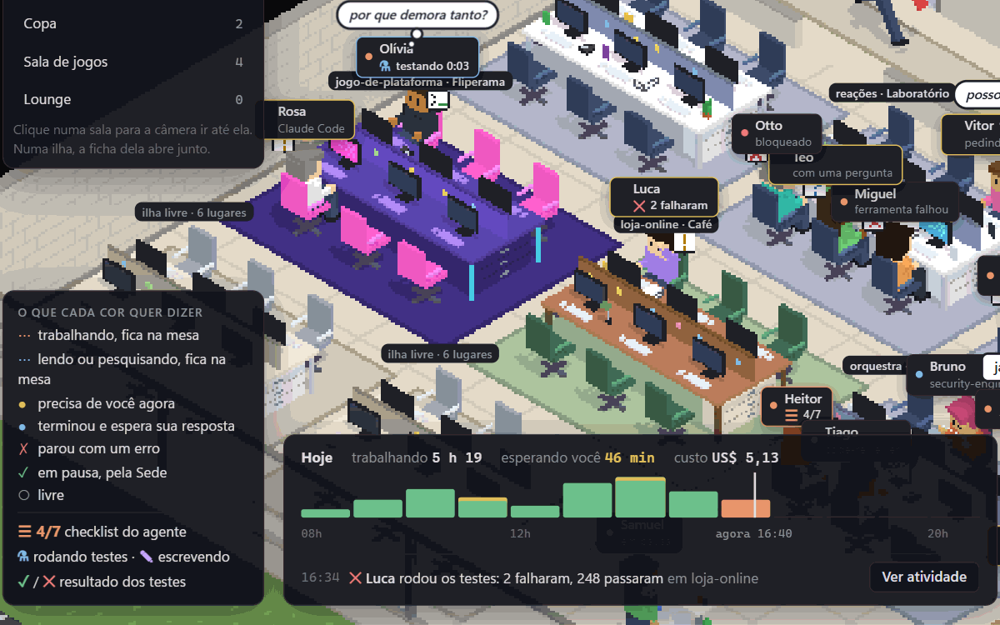
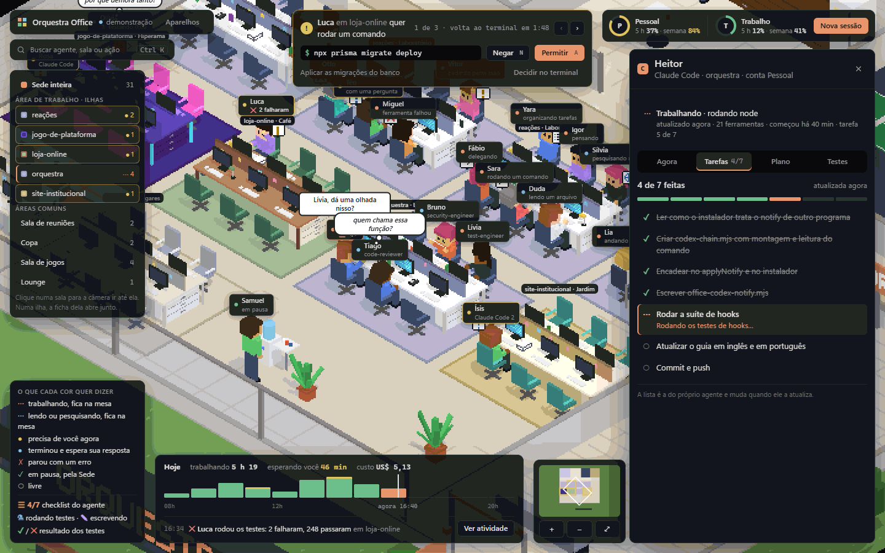
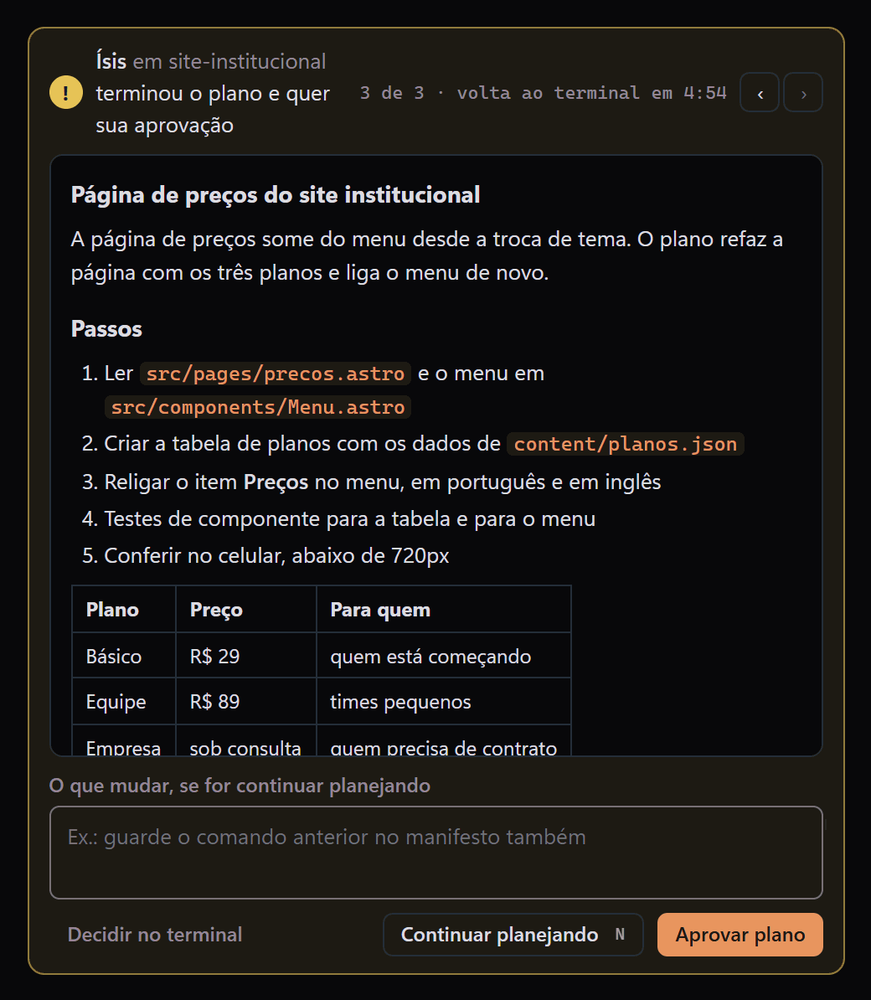
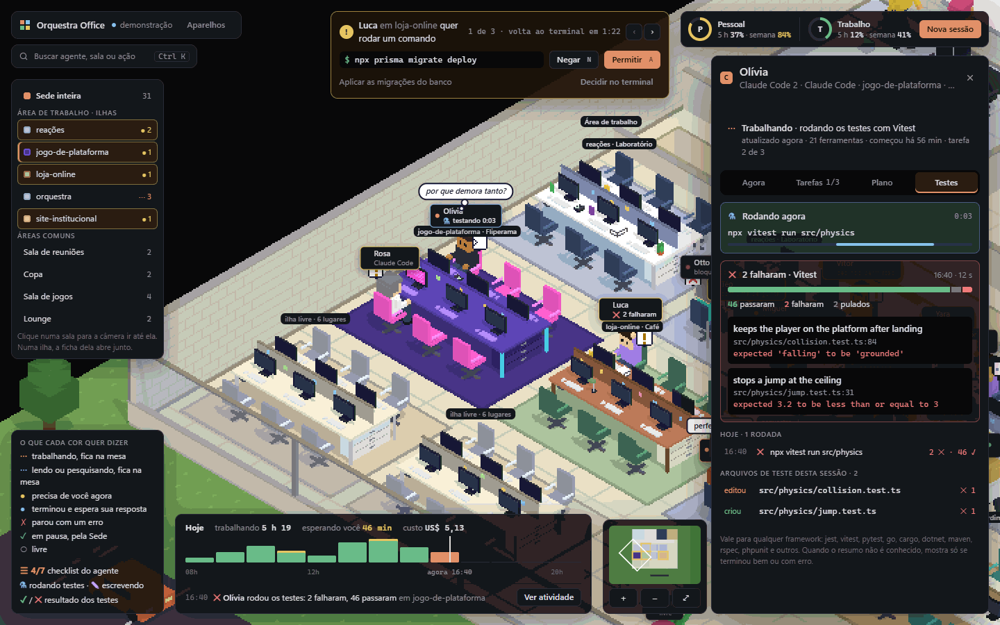

**English** | [Português (Brasil)](guia.md)

# Guide

How the office behaves once it is installed. Installing, pairing and uninstalling are in the [README](../README.md). The interface is in Portuguese only, so buttons are named in English with the on-screen label in parentheses.

## The Sede (HQ)

- Every project shares the same Sede, a single-storey open-plan building seen from above. Each project gets an island of 6 desks in the work area; a project with more people gets more than one island. Sessions and their subagents sit together, and free desks stay visible.
- Each island has one of 7 themes, which paints its carpet, desks and chairs: Lab (Laboratório), Café, Library (Biblioteca), Garage (Garagem), Space station (Estação espacial), Garden (Jardim) and Arcade (Fliperama). Pick the theme in the island sheet, which opens from the project name in the rooms list or with a click on the island.
- Around the islands are the common areas, shared by every project: meeting room, pantry, game room, lounge and reception, plus the yard in front of the building.
- Every character wears a tag with its name, its title and the color of its status. Characters with queued messages show how many on the tag and in the island sheet. While an agent tests or works through its checklist, the tag also shows a sign (see [Signs over the character](#signs-over-the-character)).
- A session opened in a git worktree joins the island of the main repository.
- Roles defined in the project's `.claude/agents` get a named desk even when nobody is in that role. Only the file names are read.
- The interface follows the Orquestra Design System: the same color, type, spacing and radius tokens (`web/styles/tokens.css`), statuses always with a glyph and text, and the app's terminal panel.

## The agent sheet

Click a character, or its name in the island sheet or in search (`Ctrl K`, `Cmd K` on a Mac), to open its agent sheet in the drawer on the right. It holds the answer options, the message box and the history.

To widen the drawer, hover over its left edge and drag. The browser remembers the width; a double click on the edge resets it, and with focus on the edge the arrow keys change the width too.

The sheet has four tabs: Now (Agora), Tasks (Tarefas), Plan (Plano) and Tests (Testes). Now holds the status, the terminal and the message box, described below. The other three are in [Checklist, plan and tests](#checklist-plan-and-tests).

The terminal in the agent sheet:

- Each line has the time and an icon colored by tool type: read, edit, command, web, delegation, task list.
- The agent's replies are rendered as markdown, with lists, bold, links and code blocks with syntax colors.
- An edit shows as a diff, with removed lines in red and added lines in green. A written file shows with its language's colors, and a command shows with `$` in front. Details longer than 12 lines start collapsed.
- Commands and code blocks have a copy button.
- If you scroll up to read, the terminal does not pull you back down: "↓ new lines" (↓ novas linhas) shows up when something new arrives.
- The expand button, in the corner of the terminal, opens the terminal over the whole page; Esc or the same button closes it.

## Approve, deny and answer

When Claude Code is about to ask for a permission or ask a question, the hook holds the request in the collector and it shows up in the office. You decide there and the answer goes back to the session.

- A request is only held if a paired office page is open. Without one, it goes straight to the terminal, as usual.
- Only a paired page decides. If the collector's reply is not signed with this machine's secret (an old collector, or the collector stopped and another program on port 8420), the request goes to the terminal. An approval from the office never rewrites the command, never saves a permission rule and never changes the session's permission mode.
- The collector holds a request for up to 120 seconds (the container's `OFFICE_HOLD_SECONDS` variable). With no answer by then, or if you click Decide in the terminal (Decidir no terminal), the request goes back to the terminal.
- While a request is held, the terminal shows "Esperando você no escritório" (waiting for you in the office).
- When you deny, you can write the reason. The agent reads it.

## Checklist, plan and tests

Claude Code reports the agent's task list, its plan and its test runs. The office shows them in the agent sheet and over the character. Codex only reports the end of each turn, so none of this shows for Codex agents. In demo mode (`?modo=demo`), the sample agents show all of it.

### Signs over the character

The tag over the character shows one sign at a time, the first one that applies:

| Sign | When |
|---|---|
| ⚗ testing 0:12 (testando 0:12) | tests are running; the clock counts the time |
| ✕ 2 failed (2 falharam) | the last run failed, until the next run |
| ✓ 250 passed (250 passaram) | the last run passed, for 1 minute after it ends |
| ✎ writing test (escrevendo teste) | the last file the agent created or edited is a test file, for up to 1 minute |
| ☰ 4/7 | the checklist has open items: 4 of 7 done |

With none of them, the tag shows only the name, the title and the status. The legend (Legenda) explains the signs. The island sheet shows, for each agent, the checklist count and the result of the last run. The timeline in the Today panel (Hoje) lists each test run and each approved plan, for example "ran the tests: 2 failed, 248 passed" (rodou os testes: 2 falharam, 248 passaram).

<p><br><sub>Signs over the characters: ⚗ testing, ✓ passed, ✕ failed, ✎ writing a test and ☰ checklist.</sub></p>

### Tasks

The Tasks (Tarefas) tab shows the agent's own checklist, the one it builds with Claude Code's task tools. Each item has its status: to do (a fazer), in progress (em andamento) or done (feito). The count, such as "4 of 7 done" (4 de 7 feitas), also shows on the tab. The list only changes when the agent updates it.

<p><br><sub>Tasks (Tarefas) tab: the agent's checklist, with 4 of 7 done.</sub></p>

### Plan

When the agent finishes a plan in plan mode and asks to go ahead, the permission alert at the top shows the plan itself, under the agent's name and "finished the plan and wants your approval" (terminou o plano e quer sua aprovação).

- Approve plan (Aprovar plano) only works with a click. It has no keyboard shortcut, so nobody approves a plan without reading it.
- Keep planning (Continuar planejando), or the N key, denies the request and sends what you wrote in the field to the agent, which goes back to planning with it.
- Decide in the terminal (Decidir no terminal) sends the request back to the terminal, like any other permission request.
- A plan longer than 20,000 characters arrives cut; the rest is in the terminal.

The Plan (Plano) tab shows the latest version, its state (waiting for your approval, approved, or replaced by a new version) and the time. It fetches the text from the collector when you open it. The text only lives in the collector's memory: after a restart, the tab says the collector no longer has it.

<p><br><sub>Plan in the permission alert: Approve plan (Aprovar plano) by click only, or Keep planning (Continuar planejando) with a comment.</sub></p>

### Tests

The office recognizes a test run in any language, in three ways:

- **By the command.** jest, vitest, mocha, `node --test`, playwright, cypress, pytest, tox, `go test`, `cargo test`, `dotnet test`, maven, gradle, rspec, `rails test`, phpunit, pest, `mix test`, `flutter test`, `swift test`, and the `test` scripts of npm, pnpm, yarn and bun, among others. A `cd` or environment variables at the start of the command do not get in the way.
- **By the output.** The summary of 15 frameworks gives the passed, failed and skipped counts: jest, vitest, pytest, node:test and TAP, go, cargo, dotnet, maven, gradle, mocha, rspec, phpunit, mix and playwright. Jest, vitest, pytest, node:test, TAP, go, cargo and rspec also give each failure's name, file and line, and message. Without a summary it knows, the office only says whether the command ended well or with an error.
- **By the test files.** Names such as `*.test.*`, `*.spec.*`, `__tests__/`, `test_*.py`, `*_test.go`, `*Test.java`, `*Tests.cs`, `*_spec.rb` and `*Test.php`, and the `test/`, `tests/` and `spec/` folders.

The Tests (Testes) tab shows:

- the run in progress, with its clock;
- the last run, with the passed, failed and skipped counts and up to 10 failures with name, file and line, and message;
- today's runs, the latest first;
- the session's test files, whether the agent read, created or edited each one, and how many failures of the last run were in it.

When the last run failed and the tab is not open, the tab gets a red dot.

<p><br><sub>Tests (Testes) tab: the run in progress, the last run with each failure and the test files.</sub></p>

The office never keeps the whole test output: only the counts and up to 10 failures. Secrets in the command, the failures, the plan and the checklist are masked, and the checklist, the failures and the plan text never reach the disk. The README's [What is stored](../README.md#what-is-stored) has the details.

## Sending messages

In sessions opened from the office, a message arrives right away. In sessions you opened in the terminal, a message written in the agent sheet waits in a queue and reaches the agent when it finishes its current turn: instead of stopping, it reads the message and carries on. A session that is already stopped, waiting for you in the terminal, only gets the message at the end of its next turn, because hooks cannot wake up a stopped session.

## Opening sessions from the office

Hooks only observe a session you opened in the terminal. For a live terminal and instant messages, the office has to own the session. The runner does that: a small Node process with no dependencies that runs on your machine, outside Docker.

```bash
node runner/src/main.js
```

With the runner on, the page shows New session (Nova sessão) at the top and in each island sheet. You give the project folder and the first message, and the runner opens Claude Code in that folder in streaming mode. The agent sheet then shows the live terminal (text arrives while the agent writes), Interrupt (Interromper) and End session (Encerrar sessão). Permission requests from these sessions reach the office like any other.

- It is Claude Code in non-interactive mode, not the terminal UI: there are no slash commands and no Claude Code interface, only the conversation.
- The runner listens on `127.0.0.1:8421` and only serves requests that carry one of its tokens. A paired page gets the token on its own: it asks the runner for a challenge, the collector signs the challenge with the secret, and the runner exchanges the signature for a 12-hour token. Any other process on the machine, without the secret, cannot open a session or send a message.
- Variables: `OFFICE_RUNNER_PORT`, `OFFICE_ORIGINS`, `CLAUDE_BIN`, `OFFICE_RUNNER_MODEL` and `OFFICE_SECRET_FILE` (default `~/.orquestra-office/secret`).
- Sessions opened by the runner end when the runner stops.

## Usage, tokens and cost

Claude Code only hands these numbers to the terminal status line. The installer sets up the office status line (`hooks/office-statusline.mjs`), which passes the numbers on to the collector and shows the model, the 5-hour and weekly usage and the session cost in the terminal.

- The 5-hour and weekly windows show in the top corner of the page, one ring per account. They only exist for claude.ai subscribers, and only after the session's first reply.
- Tokens and cost for the day are under "Today on this island" (Hoje nesta ilha), in each island sheet, and count what was spent while the office was on. The cost is Claude Code's own estimate, at list price.
- If you already have a status line of your own, the installer leaves it alone and tells you. Without the office status line, these numbers stay empty.

## Life in the office

The character reacts to what the agent is doing and moves around the Sede.

| The agent is | The character |
|---|---|
| editing a file | types |
| reading or searching the code | reads a sheet of paper, head moving from side to side |
| running a command | leans back and watches, with the terminal bubble |
| searching the web | looks around, with the globe bubble |
| starting to think about your prompt | hand on chin, with the three dots |
| delegating to a subagent | points at the colleague |
| organizing the task list | writes, with the list bubble |
| with a tool that failed | shakes its head |
| asking for permission or with a question | raises a hand, with the exclamation or question mark bubble |
| stopped with an error | facepalms |
| just finished the turn | leans back in the chair for a few seconds, with the check mark bubble |
| on break or waiting for your reply | gets up for a coffee in the pantry, then follows the free-time routine |
| idle | goes to the lounge sofa, then follows the free-time routine |
| ended | leaves through the front door |

**Whoever is working stays seated.** Only free time takes someone out of the chair. If work arrives for someone far from the desk, they hurry back. If desks move (a subagent arrives or leaves), whoever was seated shows up at the new desk without getting up.

Characters on break, waiting for your reply or idle do not stand still. After leaning back at the desk for a moment, each one switches activity every 30 to 55 seconds, at its own pace and order, and no two take the same spot, even from different projects:

- coffee in the pantry or water at the water cooler;
- looking out of the pantry window;
- writing on the meeting room whiteboard or sitting at the meeting table;
- ping-pong or the arcade machine in the game room, or resting on the beanbag;
- napping on the lounge sofa;
- watering the plants;
- stretching at their own desk, when every spot is taken.

The activities are the same for every project, whatever the island theme. Whoever needs you or is stuck on an error stays at the desk.

Each character has a temperament of its own, fixed per agent: how long it stays seated after finishing, how often it switches activity, its walking speed, its typing and blinking rhythm. That is why nobody moves in sync with the colleague next to them. Also:

- **Thought bubbles.** Now and then a thought bubble appears above the tag, tied to what the character is doing: the file it edits, the command it runs, the colleague it delegated to, or the coffee and the window during free time. At most three are visible at once, always the most recent.
- **Desk gestures.** Characters working at the desk pause for a moment from time to time: look to the side, stretch the neck, scratch the head, sip coffee, lean back with hands behind the head or rub their eyes.
- **Blinking.** Everyone blinks, except whoever is napping.

### Conversations

Characters talk to each other, with speech bubbles, one at a time, facing whoever is listening:

- **Delegation.** When a subagent starts, the main agent turns to it and hands over the task, and the subagent answers. Both stay seated, because they are working.
- **Hand-off.** When the subagent finishes, it carries the result to the main agent's desk, says it is done, hears the thanks and only then leaves through the door. If the main agent is not at the desk, the subagent leaves right away.
- **Free-time chat.** Idle characters who stop near someone in the same area (at the coffee machine, on the sofa, in the game room) start a conversation, including with people from other projects. Partitions separate conversations: someone in the pantry does not talk to someone in the game room, even leaning on the same wall. The chat goes on while they stay together, changing topic from time to time.

Characters in a conversation show no thought bubble.

Whoever arrives after the Sede is already open comes in through the reception and walks to the desk. Everyone walks along the corridors, never through walls, partitions, islands or furniture. With "reduce motion" turned on in the system, nobody walks: each character appears directly in place.

## How the installers change your configuration

The two installers, `hooks/install-claude-hooks.mjs` and `hooks/install-codex-notify.mjs`, only touch what the office wrote. The exact commands are recorded in `orquestra-office.json`, in the same folder as the configuration, and a hook of yours that merely looks like the office's stays where it is. They can run again without duplicating anything and, when there is nothing to change, they neither write nor back up. Codex accepts a single `notify`. If you already have one, such as the Codex app's for computer use, the installer does not delete it: the office runs `hooks/office-codex-notify.mjs` instead, which reports to the office and then hands the same turn to your command, without a shell. With `--remove`, your command is back on its own. A `notify` that is not written on one line as a list of strings stays as it is, and the installer tells you.

- **Backup.** Before writing, each installer copies the file to `settings.json.bak-<date>` or `config.toml.bak-<date>` and keeps only the three latest backups. The copy is complete: if the `env` block of your `settings.json` has tokens or passwords, so does the backup. On macOS and Linux the backup is readable only by your user; on Windows it inherits the folder's permissions.
- **Writing.** The file is replaced in one go, and a `settings.json` that is a symlink stays a symlink. If Claude Code saves the file while the installer runs, nothing is written and the installer asks you to run it again.
- **Address.** Hooks talk to `http://127.0.0.1:8420`. To use another port, set `OFFICE_URL` before installing, with an address on this machine (`127.0.0.1` or `[::1]`) and no path. `localhost` becomes `127.0.0.1`, because on Windows it resolves to `::1` first, where another process could be listening. That also applies to the `--office-url` written by an earlier install; the activity `curl` only changes when you reinstall. An address on another machine requires `--allow-remote-office` and `https://`, because hooks send commands and tool output there. The address is written into every command (the activity `curl` and the `--office-url` of `office-session-start.mjs`, `office-statusline.mjs` and `office-decision.mjs`), and the secret's path into the `office-decision.mjs` command. None of them reads `OFFICE_URL` during the session, because a project's `.claude/settings.json` can set environment variables and send the token somewhere else. A command written by an earlier version, without `--office-url`, uses the default until you reinstall.
- **Folder.** The path of the office folder and of the secret go inside the written command, so the installer refuses a path with characters the shell interprets, such as `$`, a backtick, quotes or `;`.
- **Secret.** The installer creates `~/.orquestra-office/secret` when it is missing and never overwrites it; `--rotate-secret` replaces the key (see [Pair your browser](../README.md#pair-your-browser)). When run in a terminal, the Claude Code installer finishes by opening the paired office, if the collector answers.
